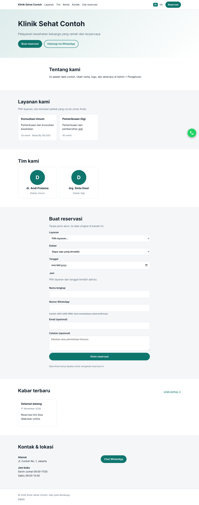
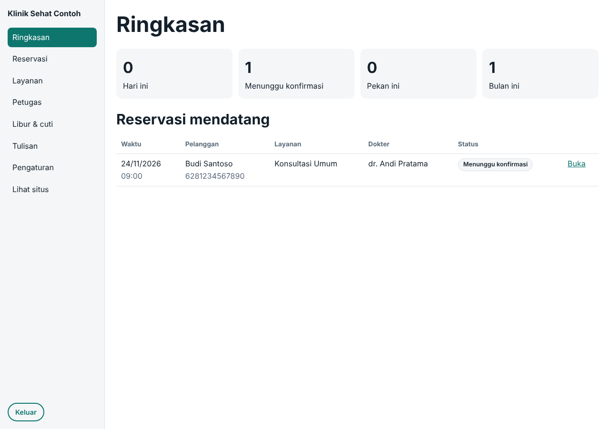
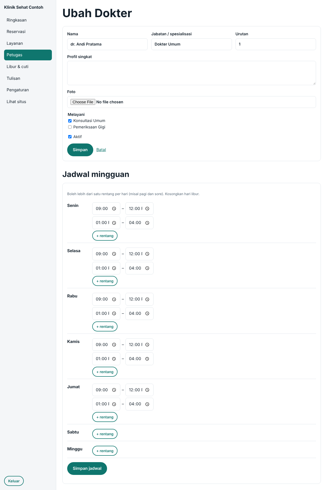

# Website Booking

Sistem reservasi dan jadwal yang bisa dipakai ulang untuk klinik dan UMKM: klinik, salon, barber, studio, bengkel, dan usaha lain yang melayani pelanggan lewat janji temu.

Satu instalasi untuk satu bisnis. Nama, logo, warna, dan istilah ("Dokter", "Terapis", "Barber") diganti dari panel admin tanpa menyentuh kode, jadi template yang sama bisa dipasang untuk banyak klien.



## Fitur

**Untuk pelanggan (tanpa login)**
- Landing page: profil bisnis, layanan, tim, formulir reservasi, kabar terbaru, kontak, dan tombol WhatsApp mengambang
- Pilih layanan, petugas (atau "siapa saja yang tersedia"), tanggal, lalu jam kosong
- Kode reservasi; cek status atau batalkan dengan kode + nomor WhatsApp
- Bahasa Indonesia secara bawaan, otomatis Inggris bila browser berbahasa Inggris, bisa diganti manual (ID/EN)

**Untuk pemilik bisnis (panel admin)**
- Ringkasan: reservasi hari ini, menunggu konfirmasi, pekan ini, bulan ini
- Reservasi: cari, saring (status, petugas, tanggal), ubah status, catatan internal, hubungi pelanggan via WhatsApp
- Layanan dengan durasi dan label harga bebas (tanpa pembayaran)
- Petugas/dokter dengan jadwal mingguan masing-masing, boleh lebih dari satu rentang per hari
- Libur dan cuti: per petugas atau seluruh bisnis
- Tulisan/berita untuk landing page (draf atau terbit, gambar sampul)
- Pengaturan: nama bisnis, logo, warna, kontak, jam buka, istilah, aturan reservasi
- Ekspor riwayat reservasi ke CSV (UTF-8, langsung terbuka di Excel)

**Di balik layar**
- Perhitungan jam kosong dari jadwal, cuti, dan reservasi yang ada
- Anti dobel-booking (transaksi database dan penguncian baris)
- Honeypot dan pembatasan laju (throttle) pada formulir publik
- Ekspor CSV aman dari "CSV injection"
- Berjalan di SQLite, MySQL, atau PostgreSQL tanpa mengubah kode

| Ringkasan admin | Jadwal dokter |
|---|---|
|  |  |

## Kebutuhan

- PHP 8.2 atau lebih baru, dengan ekstensi `pdo_sqlite`, `mbstring`, `openssl`, `fileinfo`, `gd` (untuk unggah gambar)
- [Composer](https://getcomposer.org)
- Tidak perlu Node.js atau npm. CSS dan JavaScript sudah ada di `public/`.

## Instalasi lokal

```bash
git clone https://github.com/<username>/janji-booking.git
cd janji-booking
composer setup
```

`composer setup` memasang dependensi, membuat `.env`, membuat kunci aplikasi, membuat `database/database.sqlite`, menjalankan migrasi, dan membuat tautan `storage`.

Lalu buka `.env` dan isi akun admin pertama:

```
ADMIN_EMAIL=admin@contoh.com
ADMIN_PASSWORD=kata-sandi-yang-kuat
```

Buat admin dan data contoh, lalu jalankan:

```bash
php artisan db:seed
php artisan serve
```

- Situs: http://localhost:8000
- Admin: http://localhost:8000/admin

`db:seed` membuat contoh klinik (2 layanan, 2 dokter, jadwal, satu tulisan) hanya jika data layanan masih kosong. Ganti isinya lewat panel admin, atau hapus data contoh sebelum dipakai klien.

> Jangan menulis kata sandi atau kunci apa pun ke dalam kode atau repositori. Semuanya lewat `.env`.

## Memakai untuk klien baru

1. Salin proyek (fork atau salinan repo) dan siapkan `.env` baru
2. Jalankan migrasi dan `db:seed`, lalu masuk ke **Admin > Pengaturan**
3. Isi nama bisnis, unggah logo, pilih warna, isi nomor WhatsApp dan alamat
4. Ganti istilah petugas, misalnya "Dokter" / "Doctor" atau "Barber" / "Barber"
5. Tambah **Layanan**, tambah **Petugas**, tandai petugas melayani layanan mana, lalu atur **jadwal mingguan**
6. Isi **Libur & cuti** untuk hari tutup
7. Tulis beberapa **Tulisan** untuk landing page

Aturan reservasi (di Pengaturan): jarak antar jam mulai (10 sampai 60 menit), minimal pesan sebelum berapa jam, maksimal pesan di muka berapa hari, dan apakah reservasi langsung berstatus "Dikonfirmasi".

## Pindah ke PostgreSQL atau MySQL

Ubah `.env`, lalu migrasi:

```
DB_CONNECTION=pgsql        # atau mysql
DB_HOST=127.0.0.1
DB_PORT=5432
DB_DATABASE=janji
DB_USERNAME=...
DB_PASSWORD=...
```

```bash
php artisan migrate
php artisan db:seed
```

## Tes

```bash
php artisan test
```

17 tes mencakup jadwal per dokter, cuti dan libur, dobel-booking, jam minimum pesan, honeypot, cek dan batal reservasi, login admin, ekspor CSV, dan pergantian bahasa.

## Struktur singkat

```
app/Services/Availability.php     perhitungan jam kosong
app/Services/BookingService.php   membuat reservasi (transaksi + penguncian)
app/Http/Controllers/Site/        halaman publik
app/Http/Controllers/Admin/       panel admin
app/Models/Setting.php            pengaturan bisnis (kunci-nilai, di-cache)
config/booking.php                nilai bawaan pengaturan
lang/id, lang/en                  terjemahan
resources/views                   tampilan Blade
public/css, public/js             CSS dan JavaScript tanpa proses build
```

## Produksi

- `APP_ENV=production` dan `APP_DEBUG=false`
- Gunakan MySQL atau PostgreSQL, bukan SQLite, bila banyak pengguna bersamaan
- Jalankan `php artisan storage:link` agar logo dan gambar tampil
- Atur `APP_URL`, `APP_TIMEZONE` (bawaan `Asia/Jakarta`), dan `SESSION_DRIVER`/`CACHE_STORE` sesuai hosting
- Lakukan cadangan database dan folder `storage/app/public` secara berkala
- Arahkan web server ke folder `public/`

## Privasi

Sistem menyimpan nama dan nomor telepon pelanggan serta catatan yang mereka tulis. Untuk klinik, hindari mewajibkan data kesehatan rinci di kolom catatan, beri tahu pelanggan bagaimana datanya dipakai (UU PDP), dan batasi siapa yang punya akun admin.

## Batasan saat ini

- Tidak ada pembayaran atau uang muka; harga hanya label teks
- Tombol WhatsApp berupa tautan `wa.me` (membuka chat), bukan WhatsApp API; belum ada pesan otomatis
- Panel admin berbahasa Indonesia; situs publik dua bahasa
- Satu bisnis per instalasi (bukan multi-tenant)
- Belum ada pengingat email, kalender sinkron, atau banyak akun admin dengan hak akses berbeda

## Ide pengembangan

- Pengingat otomatis (email atau WhatsApp API)
- Terjemahan panel admin ke Inggris
- Pengelolaan beberapa akun admin dan peran
- Jadwal khusus tanggal tertentu (lembur, jam tambahan)
- Cloudflare Turnstile atau CAPTCHA lain untuk formulir publik

## Lisensi

Tentukan lisensi sebelum dibagikan ke pihak lain (misalnya MIT) dan tambahkan berkas `LICENSE`.
